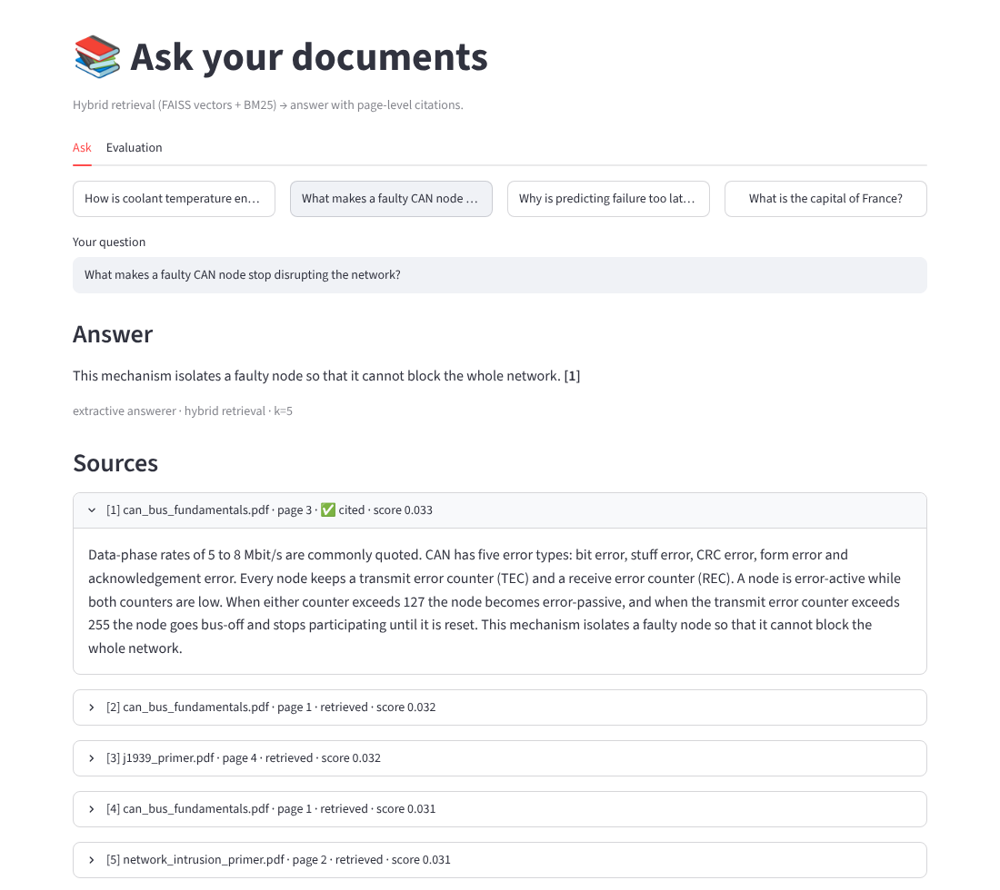
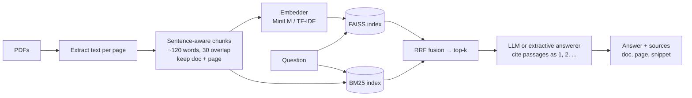
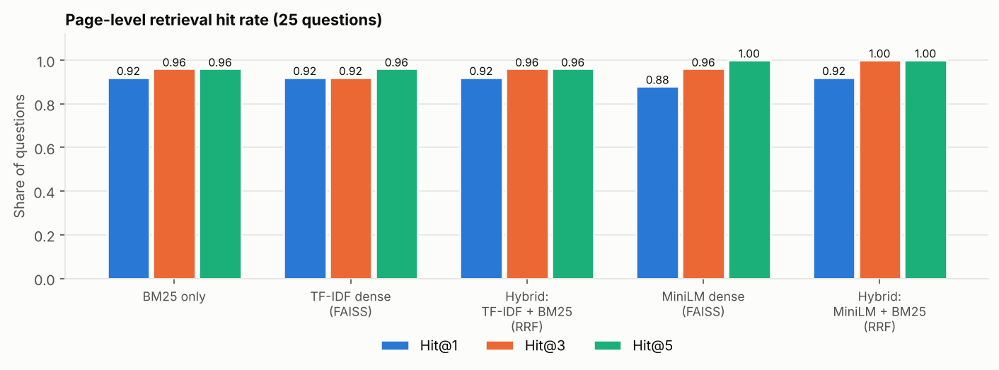

# Document Q&A Assistant (RAG) with Page-Level Citations and a Built-in Evaluation

> Ask questions about your PDFs and get answers **with the page they came from**. Hybrid retrieval (FAISS dense vectors + BM25 keywords, fused with Reciprocal Rank Fusion), pluggable LLM backends, a Streamlit UI, and, the part most RAG demos skip, a **labelled question set that measures retrieval quality** instead of eyeballing it.

**[Live demo](https://rag-docqua-demo.streamlit.app/)** (free hosting: if the app has been idle it takes about 30 seconds to wake up). The hosted demo uses the lightweight TF-IDF embedder; the MiniLM results below need the full install.



## Features

- **Ingestion:** PDF → pages → sentence-aware overlapping chunks that never cross a page boundary, so every chunk maps to exactly one citable `(document, page)`.
- **Hybrid retrieval:** exact FAISS inner-product search over L2-normalised embeddings **plus** BM25, merged with Reciprocal Rank Fusion (RRF). Switchable: `hybrid | dense | bm25`.
- **Two embedders:** `minilm` (`sentence-transformers/all-MiniLM-L6-v2`, neural, 384-d) and `tfidf` (no download, works offline).
- **Three answer backends:** Anthropic (Claude), any OpenAI-compatible endpoint (incl. local servers such as Ollama), and an **offline extractive answerer** that needs no API key. Every answer cites passages as `[n]`; prompts treat retrieved text as untrusted data (basic prompt-injection hygiene); the model is told to say "I could not find that in the documents" when the context lacks the answer.
- **Evaluation harness:** `docqa eval` computes Hit@k, MRR, context recall and answer checks over a hand-labelled question set, compares retrievers and chunk sizes, and writes a report + figures.
- **CLI + Streamlit UI**, 25 tests (one of which validates that every evaluation question's gold page really contains its answer).



## Quickstart

```bash
git clone https://github.com/shubham-patel-7/rag-document-qa.git
cd rag-document-qa
python -m venv .venv && source .venv/bin/activate      # Windows: .venv\Scripts\activate
pip install -r requirements-full.txt && pip install -e .   # requirements.txt alone = light install (TF-IDF only, no PyTorch)

python scripts/make_sample_docs.py                     # (re)generate the 6 sample PDFs
docqa ingest --docs data/sample_docs --index index/sample --embedder minilm   # first run downloads ~90 MB model
docqa ask "How is coolant temperature encoded in J1939?" --index index/sample
streamlit run app/streamlit_app.py                     # web UI; upload your own PDFs there
pytest -q
```

Use `--embedder tfidf` to skip the model download. For a real LLM answerer, copy `.env.example` to `.env` and set `ANTHROPIC_API_KEY` (or `OPENAI_API_KEY`, optionally `OPENAI_BASE_URL` for a local server); `--llm auto` then picks it up. **Never commit `.env`** (it is git-ignored).

Index your own documents: `docqa ingest --docs path/to/pdfs --index index/mine`. Scanned PDFs without a text layer need OCR first (e.g. `ocrmypdf`).

## Evaluation

### Setup

- **Corpus:** 6 short PDFs (19 pages, 30 chunks at the default chunk size) covering CAN bus, SAE J1939, predictive maintenance, diesel diagnostics, frequency hopping/BER and intrusion detection. They are educational summaries **written for this repo** (generated by `scripts/make_sample_docs.py`), so the page numbers are deterministic.
- **Questions:** 25 in `data/eval/questions.json`; each has a gold `(document, page)` and keywords that a correct answer must contain. 14 are **factoid** (they share words with the answer) and 11 are **paraphrases** (little word overlap, e.g. *"How does CAN decide which of two simultaneous senders goes first?"* for a passage about *non-destructive bitwise arbitration*).
- **Metrics:** **Hit@k**, the gold page appears in the top-k chunks; **MRR**, mean reciprocal rank of the first gold-page chunk; **context recall@k**, all answer keywords appear somewhere in the top-k text; **answer keyword accuracy** and whether the answer **cites the gold page**.
- A unit test checks that every gold page really contains its answer keywords, so the evaluation set cannot silently be wrong.

### Retrieval results

| Retriever | Hit@1 | Hit@3 | Hit@5 | MRR | Context recall@5 | Hit@3 (factoid) | Hit@3 (paraphrase) |
|---|---|---|---|---|---|---|---|
| BM25 only | 0.92 | 0.96 | 0.96 | 0.94 | 0.96 | 1.00 | 0.91 |
| TF-IDF dense (FAISS) | 0.92 | 0.92 | 0.96 | 0.93 | 0.96 | 1.00 | 0.82 |
| Hybrid: TF-IDF + BM25 (RRF) | 0.92 | 0.96 | 0.96 | 0.93 | 0.96 | 1.00 | 0.91 |
| MiniLM dense (FAISS) | 0.88 | 0.96 | 1.00 | 0.93 | 1.00 | 1.00 | 0.91 |
| **Hybrid: MiniLM + BM25 (RRF)** | 0.92 | **1.00** | 1.00 | **0.95** | 1.00 | 1.00 | **1.00** |



*MiniLM rows were computed with an ONNX export of the same `all-MiniLM-L6-v2` checkpoint (mean pooling, L2-normalised, 256-token limit); running `docqa eval --embedders tfidf minilm` with `sentence-transformers` should reproduce them up to floating-point noise.*

### Answer check (hybrid retrieval, top-5, offline extractive answerer)

| Embedder | Answer contains all gold keywords | Answer cites the gold page |
|---|---|---|
| TF-IDF + BM25 | 0.60 | 0.88 |
| MiniLM + BM25 | 0.80 | 1.00 |

### How to read these numbers honestly

- **On this corpus every retriever is near ceiling, and the differences are 1-2 questions out of 25** (one question = 4 percentage points). I would **not** claim from this table that hybrid beats BM25 in general; the small, topically distinct corpus is simply easy. The harness is the contribution: point it at your own documents and questions and the same report tells you which setup actually works for *your* data.
- **The failures are informative.** Only four questions are not answered at rank 1 by every retriever:

  | Question (paraphrase) | BM25 | TF-IDF dense | MiniLM dense | Hybrid (MiniLM + BM25) |
  |---|---|---|---|---|
  | *How does CAN decide which of two simultaneous senders goes first?* | **miss** | **miss** | **rank 1** | rank 3 |
  | *How can a device send a payload bigger than one frame on a truck network?* | rank 2 | rank 4 | **rank 5** | rank 2 |
  | *Which standards body defines the communication used on truck engine networks?* | rank 1 | rank 1 | rank 2 | rank 1 |
  | *How does a radio avoid being knocked out by a single noisy frequency?* | rank 1 | rank 1 | rank 2 | rank 1 |

  Keyword search and TF-IDF both miss the first question entirely (no shared words with "arbitration"); the neural embedder finds it; the opposite happens for rarer technical wording, where BM25 outperforms the embedder. Fusing the two keeps both strengths, which is the case for hybrid retrieval, shown here on four questions, not proven.
- **Retrieval is not answer quality.** With MiniLM + BM25 the right page is in the top-3 for all 25 questions, but the extractive answerer contains all gold keywords for only 20 of 25. It returns single sentences, so answers that span two sentences (e.g. a value in one sentence and its offset in the next) are cut. That is the gap an LLM backend closes; `docqa eval --answer-llm extractive anthropic` scores a real LLM with the same checks once you set an API key. I have not included LLM-generated results because they depend on your key and model.
- **Chunk size barely matters here** (60 / 120 / 200 words give Hit@3 between 0.92 and 1.00; see `results/eval_report.md`), again because the corpus is small. On long, real documents it is usually one of the most influential settings, which is why it is a sweep in the harness.

## Design decisions

| Decision | Why |
|---|---|
| Chunks never cross page boundaries | Every citation points to one page a human can open. |
| Sentence-aware packing with overlap | Avoids cutting a fact in half; overlap keeps context across boundaries. |
| Exact `IndexFlatIP` FAISS index | Corpus sizes for single-user document Q&A are small; exact search is simpler and has no recall loss. Switch to IVF/HNSW beyond ~1M chunks. |
| RRF instead of score mixing | Dense cosine scores and BM25 scores live on different scales; RRF only uses ranks, so no weights to tune. |
| Retrieved text is wrapped in `<context>` and declared untrusted | Documents can contain instructions; the model is told never to follow them. |
| Offline extractive backend | The project runs end-to-end, and is testable in CI, without any API key. |
| LLM temperature 0 | Reproducible answers for evaluation. |
| Dense search drops zero-similarity hits | With TF-IDF, a query sharing no vocabulary with a chunk scores exactly 0 against every chunk, and the order among tied zeros is arbitrary (it even changed with `k`). An early version of this evaluation reported such arbitrary orders as real ranks; it is fixed, covered by a test, and the numbers in this README are from the corrected code. |

## Repository layout

```
src/docqa/
  config.py       defaults, paths, tiny .env loader
  ingest.py       PDF text extraction, cleaning, sentence-aware chunking
  embedders.py    MiniLM (sentence-transformers) and TF-IDF embedders, L2-normalised
  index.py        HybridIndex: FAISS + BM25 + RRF, save/load
  llm.py          Anthropic / OpenAI-compatible / extractive backends, prompt, citation parsing
  pipeline.py     DocQA: retrieve -> generate -> Answer(sources, cited flags)
  evaluate.py     Hit@k, MRR, context recall, answer checks, chunk-size sweep
  report.py       markdown report + figures
  cli.py          docqa ingest | ask | eval
app/streamlit_app.py        upload PDFs, ask, inspect sources, view evaluation
scripts/make_sample_docs.py generates the sample corpus
data/sample_docs/           6 sample PDFs     data/eval/questions.json   25 labelled questions
tests/test_docqa.py         chunking, index, RRF, prompts, mocked LLM client, eval-set integrity, CLI, headless app
```

## Limitations

- **Tiny, self-written corpus and 25 questions written by the same author:** the questions probably share more vocabulary with the text than real user questions would, which flatters keyword search. Results do not transfer to large or messy real-world PDFs (tables, multi-column layouts, scans).
- No re-ranker (e.g. a cross-encoder) and no query rewriting.
- Text only: tables and figures inside PDFs are not understood.
- LLM answers are not evaluated in the shipped report (needs your API key); the LLM call paths are covered by a mocked unit test, not by a recorded live run.
- Extractive fallback answers are single sentences and cannot synthesise across passages, and the extractive answerer does **not** reliably abstain on questions that are on-topic but unanswerable (shown in the demo runs below). The LLM backends are instructed to abstain, but that behaviour is not measured here.

## Improvements I would make next

1. A larger, harder evaluation set (hundreds of questions on long real documents, written by someone who did not write the corpus), with confidence intervals.
2. Add a cross-encoder re-ranker and measure its effect on Hit@1.
3. LLM-as-judge or human grading for faithfulness, with an explicit "unanswerable question" test set to measure abstention.
4. Table-aware PDF parsing and OCR fallback.
5. Persist multiple indexes and incremental updates in the UI.

## License

MIT (see `LICENSE`). The sample PDFs are original text written for this repository.


---

## Demo runs and result analysis

Three questions run through the full pipeline on the sample corpus (`python scripts/demo_runs.py --embedders tfidf minilm`; raw output in `results/demo_runs.json`). Answers come from the offline extractive answerer, so no API key is involved. The MiniLM rows were produced with the ONNX export of the same checkpoint described above, and the latency for them is from my sandbox CPU, so treat it as indicative only.

| Demo run | Embedder | Gold page rank: BM25 / dense / hybrid | Answer correct and cites the gold page? | Latency |
|---|---|---|---|---|
| 1. Factoid: *Who developed the CAN protocol and in what year?* | TF-IDF | 1 / 1 / 1 | **Yes**: "developed by Bosch and introduced in 1986 [1]" | 2 ms |
| | MiniLM | 1 / 1 / 1 | **Yes** (same answer) | about 200 ms |
| 2. Paraphrase: *How does CAN decide which of two simultaneous senders goes first?* | TF-IDF | 6 / miss / 6 | **No**: answers about error counters (page 3) | 2 ms |
| | MiniLM | 6 / 1 / 3 | **Partly**: cites the right page, but the first sentence is irrelevant | about 130 ms |
| 3. Not in the documents: *What is the price of a Cummins X15 engine?* | TF-IDF | n/a | **No abstention**: returns a generic sentence about diesel engines | 2 ms |
| | MiniLM | n/a | **No abstention**: returns an unrelated J1939 sentence | about 170 ms |

*"Miss" means the gold page is not in the top 10. The default answer context is the top 5 chunks.*

**What the three runs show**

1. **Easy questions work with every setup.** When the question shares words with the passage, all retrievers rank the right page first and the answer is correct, with a citation a reader can verify.
2. **Paraphrases are where the retriever choice matters.** The words "senders" and "goes first" never appear in the passage about *bitwise arbitration*. BM25 and TF-IDF cannot bridge that gap (the page is outside the top 5), so the TF-IDF pipeline answered from the wrong page. MiniLM ranks the page first on its own and third after fusion with BM25: **fusion rescued the question but ranked it below the best single retriever**, so hybrid is not automatically better than dense. That is the kind of thing the evaluation harness exists to show.
3. **Retrieval success is not answer success.** Even with the right page retrieved, the extractive answerer put an irrelevant sentence first. It picks sentences by similarity and cannot reason about the question; an LLM backend is meant to close this gap, but I have not run one live (see Limitations).
4. **The extractive answerer does not abstain on a plausible but unanswerable question.** It only says "I could not find that" when there is no word overlap *and* low similarity; "engine" overlaps with the diesel document, so it returned a confident-looking irrelevant sentence. Do not use the retrieval score as a confidence signal either: the top source scored 0.032 to 0.033 in all six runs, because an RRF score only reflects rank agreement between retrievers, not answerability. Fixing this properly needs a labelled set of unanswerable questions to tune a threshold on (Improvements, item 3), or an LLM instructed to abstain.

**A bug these runs exposed.** While building this demo I saw TF-IDF dense search return different rankings for `k=5` and `k=10`. The cause: when a query shares no vocabulary with a chunk, its TF-IDF cosine is exactly 0, and the order among tied zeros is arbitrary. Earlier versions of this evaluation reported such arbitrary orders as real ranks. Dense search now drops zero-similarity hits, a regression test covers it, and the tables in this README were regenerated (TF-IDF dense Hit@3 fell from 0.96 to 0.92; the MiniLM rows were unaffected).

**Caveats.** Three questions are an illustration, not a benchmark (the 25-question evaluation above is); the corpus is small and self-written.
